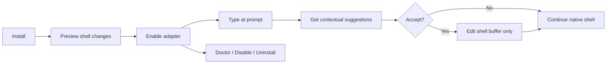

# 02 — Personas, User Stories & UX Flows

## Personas

| Persona | Context | Need | Anti-need |
|---|---|---|---|
| Mai — frontend engineer | macOS zsh + iTerm2, git/npm | Discover flags, quick keyboard control | UI nặng/chiếm focus |
| Nam — SRE | Ubuntu bash, SSH/tmux | Predictable completions, low risk | Truyền commands ra cloud |
| An — .NET engineer | Win11 + PowerShell7 | Native terminal workflow, unicode path | Hook phá PSReadLine/history |

## Top user stories (INVEST-friendly)

| ID | Story | Priority | Acceptance pointer |
|---|---|---|---|
| US-01 | Là developer, tôi thấy subcommands khi gõ prefix để đỡ tra help | P0 | FR-01, FR-02 |
| US-02 | Tôi chấp nhận suggestion bằng phím mà không tự execute lệnh | P0 | FR-04 |
| US-03 | Tôi dùng terminal theme bất kỳ và popup trông cùng tone | P0 | FR-05 |
| US-04 | Tôi vẫn gõ được khi app bị crash/không chạy | P0 | FR-07 |
| US-05 | Tôi có thể cài, tắt, gỡ hoàn toàn shell integration | P0 | FR-08 |
| US-06 | Tôi nhận gợi ý file/dir phù hợp cwd | P0 | FR-03 |
| US-07 | Trên Wayland tôi vẫn dùng inline suggestion khi overlay không khả thi | P0 | FR-06 |
| US-08 | Tôi có thể thêm spec local để mở rộng command nội bộ | P1 | FR-10 |
| US-09 | Tôi kiểm tra vì sao autocomplete không hiện bằng `doctor` | P0 | FR-09 |
| US-10 | Tôi có thể tắt chạy generator trong môi trường nhạy cảm | P0 | SEC-04 |

## Use case: Autocomplete subcommand

**Precondition:** app enabled, session ở prompt, `git` spec được load.

1. Người dùng nhập `git ch`.
2. Shell adapter gửi `{session, input, cursor, cwd, generation}` qua IPC có xác thực per-user.
3. Parser hiểu token root `git` và token chưa hoàn tất `ch`.
4. Engine trả `checkout`, `cherry-pick` kèm label/description/replace range.
5. UI render popup ở caret nếu hỗ trợ, nếu không inline.
6. User nhấn Tab → shell buffer đổi thành `git checkout `, **chưa execute**.

**Alternatives:** người dùng Esc => đóng; editor đổi buffer trước reply => bỏ response cũ dựa `generation`; command password prompt/full-screen => không kích hoạt; engine down => shell native bình thường.

## Use case: Theme sync

1. Adapter xác định session/terminal, thử nguồn theme theo độ tin cậy.
2. Nếu terminal hỗ trợ query OSC 10/11 an toàn trong session: lấy màu fg/bg; nếu không dùng adapter/override/fallback.
3. UI tính theme tokens, contrast cho item selected/highlight.
4. Khi đổi profile/theme: refresh khi session nhận event/trigger thích hợp; không polling liên tục.
5. Với terminal theme không biết, dùng `auto` fallback neutral và cho `theme.mode=light|dark` thủ công.

## Use case: Safe failure

1. Daemon không phản hồi trước timeout.
2. Adapter **không block** key input; ẩn popup; trả quyền xử lý phím về shell.
3. `doctor` sau đó cho biết version mismatch/IPC/permission mà không in full command text.

## User journey (giai đoạn)

## Error/empty states

- Không có spec: ẩn UI hoặc đề xuất native filenames nếu hợp ngữ cảnh, không spam "no result".
- Query bị timeout: không hiện popup stale, không phá dòng lệnh.
- Missing accessibility permission: giải thích bằng màn cấu hình, vẫn có inline mode.
- Spec conflict: local override chỉ khi user bật, log metadata không chứa command line.
