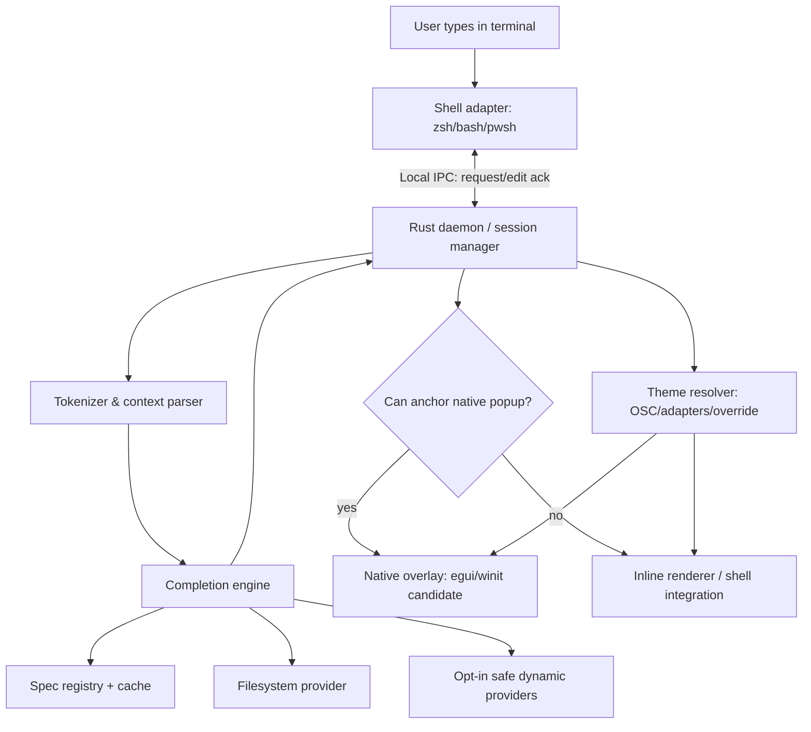
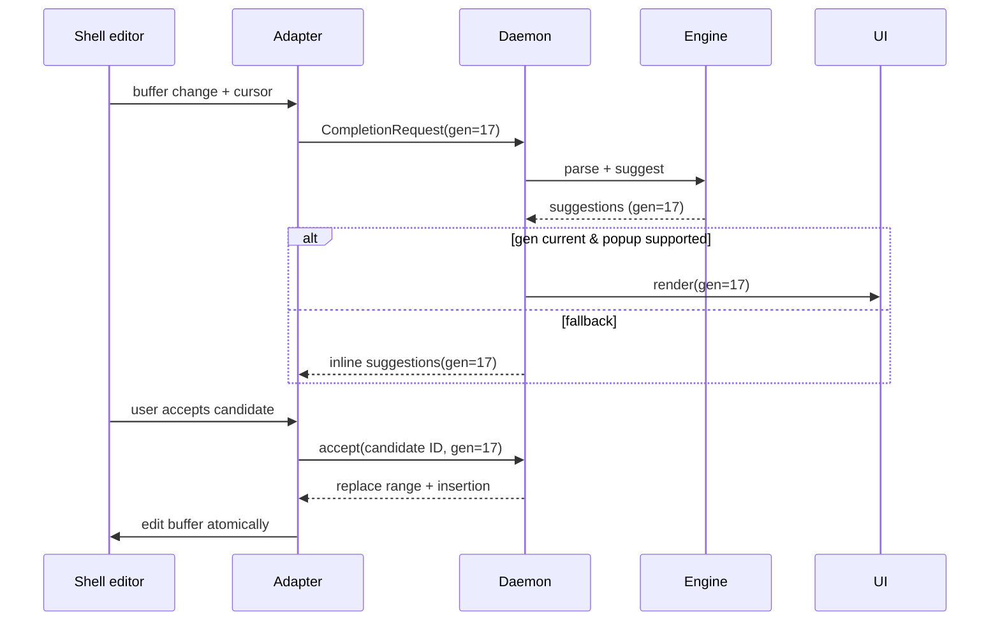

# 04 — System Architecture & High-Level Design

**Status:** Proposed, pending shell feasibility spikes.

## Architecture style

**Rust core + per-shell adapter + desktop UI / inline renderer**. Local-first, event-driven, no mandatory server.

## Components & responsibilities

| Component | Owns | Must not do |
|---|---|---|
| Shell adapter (`adapters/`) | Prompt/editor lifecycle, current buffer/cursor, apply explicit edit | Execute suggested commands, capture passwords |
| Session manager | Session ID, editor state, generation, timeout, cancellation | Share cwd/buffer across sessions |
| Parser | Partial shell grammar, quote/escape handling, cursor-aware AST | Run shell expansion or execute code |
| Completion core | Query spec tree, candidate matching/ranking, replacement range | Access network by default |
| Spec loader | Validate, version, lazy load JSON specs; cache LRU | Execute TS/JS directly from specs |
| Providers | Paths and safe built-in dynamic suggestions | Arbitrary shell-string concatenation |
| Theme resolver | Source-priority resolution, color contrast tokens | Assume OSC always works |
| Overlay UI | Position, draw, keyboard navigation states | Steal permanent keyboard focus |
| Inline adapter | Terminal-native fallback when overlay unavailable | Corrupt command buffer or stdout of piped commands |
| CLI & diagnostics | install/doctor/config/disable/update information | Dump buffers, env vars, tokens |

## Critical interaction sequence

## IPC proposal

- Unix/macOS: Unix domain socket in user runtime dir with `0700` parent, socket `0600`, peer credential verification where available; Windows: named pipe with user-scoped ACL.
- Do not trust client-supplied PID/session/user without OS-level local identity check. Handshake protocol version and runtime auth.
- Frame: length-prefixed JSON **for POC**; migrate binary serialization only if profile indicates need. Max message size default 16 KiB (configurable upper bound), limit suggestions count and description length.
- Bounded queue, debounce ~30–60 ms and cancel stale generation; total non-blocking deadline; no daemon blocking editor.
- Multiple sessions: key by random session_id (generated per shell), process identity, tty/terminal identity; ensure strict isolation.
- Transport of edit commands must include `generation` and current buffer hash; shell verifies before applying edit.

## Component deployment

1. `companion` CLI for install, doctor, config, disable.
2. `companiond` local daemon startup on demand or tray/launch agent (OS-specific; lazy lifecycle).
3. `companion-overlay` child process or mode of daemon; UI renderer backend per OS.
4. Shell adapter scripts installed in marker blocks; binary retained outside user's startup path if disabled.
5. Built-in specs packaged locally, independent versioning.

## Performance strategy

- Incremental cursor-aware tokenize, LRU parsed spec cache, worker pool only for bounded providers.
- No JS runtime in hot path; all shipped specs normalized to JSON at build-time.
- Debounce cancels stale work; static completion fast, dynamic provider either cached or timeout with no UI flicker.
- Separate UI frame budget from suggestion latency; avoid waking GPU/render loop when popup hidden.
- Emit aggregate performance counters **in-memory only** unless user opts into diagnostics export.

## Failure modes

| Failure | Expected behavior |
|---|---|
| Daemon stops | Adapter fails open, shell native behavior preserved |
| Socket unauthorized/stale | Ignore event, `doctor` reports actionable hint |
| Parser error/incomplete quote | Return conservative suggestions or none; never modify input |
| UI crash | No lost keystroke; inline fallback on next event |
| Dynamic generator timeout | Show static suggestions only |
| Theme unknown | Neutral fallback; user override |
| Caret unavailable | Inline fallback; do not guess desktop coordinates |

## Deployment constraints

No user account, cloud infrastructure or mandatory updater for MVP. Installer support depends on target OS; macOS may need Accessibility permission for positioning, not for reading unrelated apps. Windows UI Automation access varies by terminal. Linux Wayland's security model disallows universal global caret access; *no promise of consistent external overlay there*. See docs 05 and 13.
