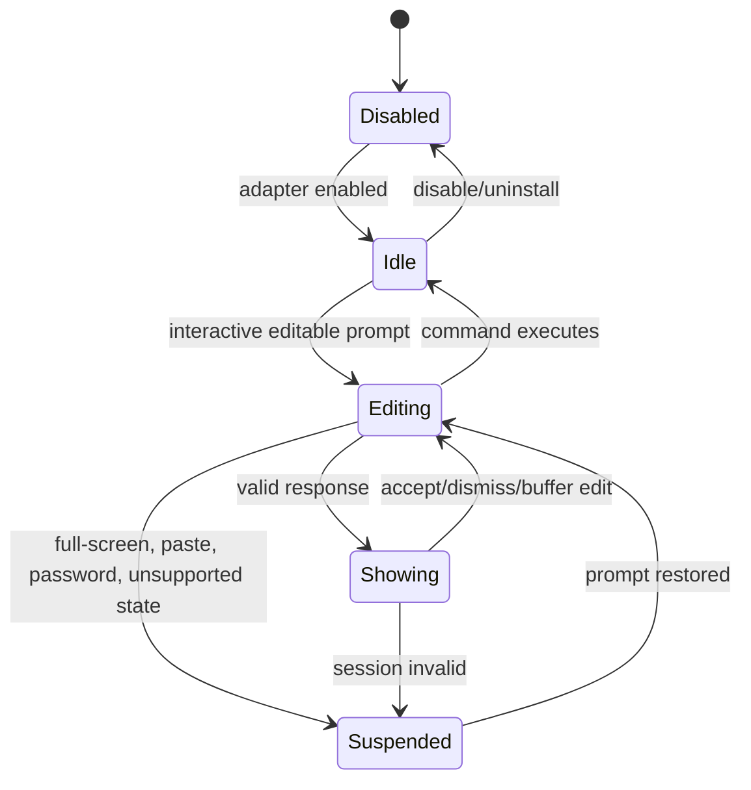

# 05 — Shell & Terminal Integration Design

## Key distinction: shell != terminal emulator

- **Shell** (zsh/bash/fish/PowerShell) owns the editable command buffer, cursor position, history and completion; provides events and applies edits.
- **Terminal emulator** (Terminal.app/iTerm2/Kitty/GNOME Terminal/Windows Terminal/IDE) paints text and may expose active window/caret position and foreground/background palette.
- **Compositor/window system** determines if an independently drawn popup can be placed above other windows. X11, macOS WindowServer, Windows desktop, Wayland have materially different security models.

Therefore we need **separate ShellAdapter, TerminalCapabilityProbe, PopupAnchorProvider**. A terminal's `TERM` string is not proof of an available positioning API.

## Integration strategy

| Platform | Shell | Event and edit strategy to spike | Caveat |
|---|---|---|---|
| macOS | zsh | ZLE custom widget wrapping editable-buffer updates and completion action | Do not shadow keymaps or disable existing widgets |
| Linux | bash | Readline `bind -x`/completion hooks POC, compare compatibility against bash-completion | Per-keystroke capture may require intrusive key bindings; explicit go/no-go |
| Windows | PowerShell 7 | PSReadLine custom key handlers with safe delegation; obtain line via PSConsoleReadLine APIs | PSReadLine version behavior varies; preserve native Tab/history |
| P1 | fish | `commandline` and fish completion integration POC | Event APIs differ from zsh/bash |

**Important:** Bash does not provide a universal non-invasive per-keystroke callback comparable to zsh ZLE; prove feasibility and cost *before* committing to popup-on-every-key. If POC fails, use completion-key-triggered suggestion as fallback.

## Editable prompt state machine



Rules: only act when session clearly editable; use bracketed-paste awareness where shell exposes it; never read password prompts; disable for alternate screen and unknown terminal modes where possible; ignore stderr/stdout from programs.

## Native popup positioning

- **macOS:** inspect Accessibility trust/terminal APIs; get caret/selection bounds if accessible; position no-activate window near anchor. Fig's prior approach reportedly used macOS Accessibility API for popup positioning and shell integration for input, but this is a reference, not universal API guarantee.
- **Windows:** investigate UI Automation TextPattern/selection rectangle of Windows Terminal and IDE terminal; no-activate topmost owner window. UIA may return unavailable/incorrect rectangles.
- **Linux X11:** target terminal window geometry plus cursor coordinates only if trustworthy; handle HiDPI, monitor transforms.
- **Linux Wayland:** global position/caret mapping across unrelated windows is commonly unavailable by design. Default to **inline menu** or supported terminal-specific integration; do not bypass compositor security or attempt raw global input interception.

**Anchor acceptance:** stable on multi-monitor/HiDPI, resize, split-pane, scroll, IME, font zoom, moved window, fullscreen; no global overlay if anchor confidence below threshold.

## Inline fallback contract

- Use shell-native completion UI APIs where available. If drawing transient terminal lines, implement robust cursor save/restore and avoid consuming real command input; **prototype per shell** first.
- Fallback can instead use a completion-key-triggered shell-native list rather than real-time popup for less capable environments.
- Preserve prompt text, readline/ZLE/PSReadLine bindings, unicode widths and paste.
- No stdout control codes if shell not interactive or output is piped.

## Terminal capability probe

Sample capability representation:

```json
{
  "session": "random-per-shell-session",
  "shell": "zsh",
  "terminal": "iTerm2",
  "display_backend": "macos",
  "caret_anchor": "verified|unavailable|unknown",
  "osc_color_query": "verified|unavailable|unknown",
  "inline_completion": "available|unavailable"
}
```

This object contains capability statuses, **not guarantees**. `verified` is per session and invalidated when terminal/focus state changes.

## Theme acquisition (must be safe)

1. User override (explicit values or preferred mode), highest priority.
2. Trusted terminal-specific API/config adapter, when accessible and accurate for **active session**.
3. OSC 10/11 query for default foreground/background (optionally OSC 4 for ANSI palette), **only through an adapter that can safely multiplex input responses**; request timeout bounded and responses filtered.
4. Reliable environment-provided hints if known; otherwise neutral dark/light fallback.

Do not emit OSC query from the overlay into an arbitrary TTY. Replies are delivered as terminal input and can contaminate the editable buffer if handled carelessly. Test tmux/screen, SSH and terminals ignoring OSC; avoid terminal-color mutation sequences entirely.

## Compat matrix & spike plan

| Spike | Matrix | Go criteria |
|---|---|---|
| S-01 zsh ZLE | macOS Terminal + iTerm2 | 10k edit events no loss, keybinding-safe, popup/inline works |
| S-02 Bash Readline | Ubuntu GNOME Terminal + Kitty | Low-overhead reliable capture or explicit fallback shipped |
| S-03 PowerShell | Win11 Windows Terminal + PSReadLine stable version | Reliable edit/undo/history, no credential prompt capture |
| S-04 macOS anchor | 2 terminals, split panes, 2 monitors | ≥ 98% anchored correctly in fixture corpus |
| S-05 Windows anchor | Windows Terminal and VS Code integrated terminal | UIA rect trustworthy, else inline mode |
| S-06 Linux X11/Wayland | GNOME Wayland + X11 | Wayland fallback never misplaced; X11 best effort |
| S-07 color sync | dark/light/custom, tmux, OSC supported/unsupported | Accurate fg/bg if verified; no buffer pollution otherwise |

Do **not** call a terminal officially supported until acceptance matrix is green. CLI `doctor` must report capability outcome by session rather than one global green checkmark.
