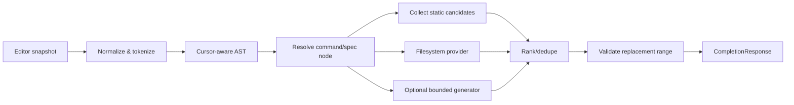

# 06 — Completion Engine, Schema & IPC Technical Design

## Objective

From **line prefix + cursor + shell + cwd** produce a safe, ranked list of suggestions and a precise edit range. The engine does **not** execute user command text. It is independent from UI, OS and shell implementation.

## Pipeline



## Parsing contract

- Parse **prefix at cursor** and know suffix after cursor so replacement doesn't erase unexpected content. Preserve raw input and a normalized representation separately.
- Start with pragmatic grammar for quotes, whitespace, escapes, `--flag=value`, short flags, subcommands, path separators and incomplete tokens. Add pipelines, command substitution and redirection cautiously. Unrecognized structure -> conservative/no suggestions.
- Character indices: define **UTF-8 byte offsets** in Rust protocol; adapters must convert from their own cursor-index convention (UTF-16 in Windows APIs where applicable) and validate boundaries to avoid slicing multibyte Unicode.
- A candidate carries `replace_start_byte`, `replace_end_byte` plus `insert_text`; display text is not insertion text.
- Do not perform glob expansion, variable substitution, subprocess invocation or shell evaluation during parsing.

## Completion spec v1

A safe, declarative JSON file with `schemaVersion=1`, `name`, description, recursive `subcommands`, `options`, `args` and `suggestions`. See [JSON Schema](../schemas/completion.schema.json) and [example](../examples/git.completion.json). This is **our own normalized format**, inspired by the public Fig completion-spec concept, not a claim of drop-in Fig runtime compatibility.

### Example

```json
{
  "schemaVersion": 1,
  "name": "tool",
  "description": "Example CLI",
  "subcommands": [{ "name": "run", "description": "Run a task", "options": [
    { "name": "--verbose", "description": "Enable detailed output", "takesValue": false },
    { "name": "--target", "description": "Target name", "takesValue": true,
      "args": [{ "name": "target", "suggestions": [{"name": "dev"}, {"name": "prod"}] }] }
  ] }]
}
```

Schema v1 intentionally excludes executable JS/TS code and remote URLs. Fig community specs may contain dynamic generators and TypeScript functions; **importer** must transform supported static structures only, report unsupported constructs, and attribute license.

## Candidate data model

| Field | Type | Meaning |
|---|---|---|
| `id` | opaque string | Stable within response for acceptance |
| `label` | string | Shown in UI |
| `description` | string? | Short accessible description |
| `kind` | enum | command/subcommand/option/argument/file/directory |
| `insert_text` | string | Shell-ready (escaped appropriately by adapter/engine contract) |
| `replace_start_byte` / `replace_end_byte` | int | Valid UTF-8 byte span in snapshot |
| `match_ranges` | `[[start_byte, end_byte], …]` | UTF-8 byte ranges of `label` that matched the typed token; ascending, non-overlapping, on character boundaries. Empty for no typed text. Display only; never used for editing |
| `score` | number | Deterministic rank; not security signal |
| `generation` | uint64 | Discard stale responses |
| `source` | enum | bundled/local/filesystem/built-in generator |

## Resolution and ranking

1. Detect command root, follow matching subcommand tree and option arguments; respect option's `takesValue`.
2. Combine providers appropriate to active argument (static choices, directory, file, dynamic if enabled).
3. Filter by prefix: exact prefix > case-folded prefix > fuzzy (P1); prioritize context match; stable alphabetical tie-break.
4. Deduplicate by `(kind, insert_text, range)`; cap visible results (e.g. 8–12) and total response (e.g. 50).
5. Empty/unknown path returns no candidates without error; no arbitrary command execution.

## Dynamic generators: deliberately limited

- MVP can ship read-only **built-in providers** (e.g. git branch names) behind an explicit allow switch; never allow raw commands embedded in downloaded specs to execute.
- Provider API is internal Rust trait: `(cwd, argv, deadline, cancellation, policy) → suggestions`.
- Spawn by argv array, no shell interpolation; restricted environment, no stdin access, per-provider timeout default 100 ms, memory/CPU limits where supported, max output size, no network (policy/enforcement platform-dependent).
- Remote/sandboxed script generators are P2 and demand separate threat model and permission design.

## IPC wire example (illustrative, not codegen schema)

Request:

```json
{
  "v": 1,
  "type": "complete",
  "session_id": "opaque-session-uuid",
  "generation": 42,
  "shell": "zsh",
  "cwd": "/home/dev/project",
  "buffer": "git ch",
  "cursor_byte": 6,
  "editor_state": "editing"
}
```

Response:

```json
{
  "v": 1,
  "type": "results",
  "session_id": "opaque-session-uuid",
  "generation": 42,
  "suggestions": [{
    "id": "git:checkout",
    "label": "checkout",
    "description": "Switch branches or restore paths",
    "kind": "subcommand",
    "insert_text": "checkout ",
    "replace_start_byte": 4,
    "replace_end_byte": 6,
    "match_ranges": [[0, 2]],
    "score": 100,
    "source": "bundled"
  }]
}
```

Accept request and reply (the adapter, not the UI, sends these):

```json
{ "v": 1, "type": "accept", "session_id": "opaque-session-uuid", "generation": 42,
  "suggestion_id": "git:checkout", "buffer_hash": "sha256:…" }
```

```json
{ "v": 1, "type": "edit", "session_id": "opaque-session-uuid", "generation": 42,
  "replace_start_byte": 4, "replace_end_byte": 6, "insert_text": "checkout ", "cursor_byte": 13 }
```

If `generation` or `buffer_hash` no longer matches, the daemon replies `{"type":"stale"}` and the adapter changes nothing. Shape of the messages: [`schemas/ipc.schema.json`](../schemas/ipc.schema.json), sample: [`examples/completion-response.json`](../examples/completion-response.json).

### Behaviour the prototype fixes as reference

The interactive prototype ([17](17-design-system-handoff.md)) is the behavioural reference for ranking and insertion: exact prefix first, then in-order subsequence matches (accent- and case-folded, so `tai` finds `Tài liệu/`), stable list order as tie-break; paths with spaces are inserted escaped; subcommands and options get a trailing space, directories end in `/` with none; accepting a subcommand opens the next context immediately. The Rust engine must reproduce these cases as golden tests.

**Privacy:** the buffer is sent **only** over authenticated same-user IPC and never persisted. Request size cap and `session_id` prevent cross-session mixups. Buffer hash/generation re-check must happen at accept time; daemon must not authorize edits based solely on an old response ID.

## Schema/version strategy

- Protocol `v` increments on breaking changes; client/daemon negotiate or disable gracefully.
- Spec `schemaVersion` independent from IPC `v`.
- On schema validation failure: skip spec, report file path plus error code (not spec contents with secrets).
- Distribution: bundled specs with signed release; local user specs are trusted data only, never executable.

## Acceptance tests

- `git ch`, `git commit -`, `git -C dir status`; `--flag=value`; paths with spaces, Unicode, hidden folders.
- Quoting incomplete (`'`, `"`), backslash, escaped space, multi-command `&&`, pipeline, cursor in middle, pasting large blocks.
- Prefix ambiguity and local override precedence.
- Stale generation response ignored, UTF-8 range validation, overlong socket messages rejected.


## Validity (as-you-type suggestions)

An explicit Tab always completes (an unknown command gets file names). Suggestions that appear **without being asked**
(the shell adapter's as-you-type mode) must not fire for every command or for nonsense, so the engine also reports
whether the line is a **recognised command in progress** (`Completion::valid`, request flag `live`):

- the first word has a completion spec (bundled or user-installed); unknown commands are not valid;
- every completed word before the one being typed is *placed* by the spec: it is a subcommand of the current node, or
  the value of an option that takes one, or fits an argument slot of the current node (a variadic argument accepts any
  number of words). A word with no place (`git foo c`, `git checkout main extra c`) makes the line invalid;
- an unterminated quote is not valid, and neither is a command word still being typed (`gi`);
- the word being typed only needs to have candidates; with none, nothing is shown.

Options are deliberately **not** checked (an unknown `--flag` does not invalidate the line), because specs list only
some of a tool's options; the cost is that a mistyped flag still shows suggestions. Alternatives considered: asking the
shell whether the command exists (`whence`/`command -v`) would make `ls`, `cat`... "valid" but with nothing to suggest
and ignore which words are meaningful; dry-running or parsing `--help` output is slow, runs user commands and breaks
the "no execution" rule. Validity is therefore only as good as the specs: with the minimal bundled `git` spec,
`git commit file` counts as invalid because the spec gives `commit` no arguments.

## Matching rules for what is typed

- Exact prefix, then case- and accent-folded prefix, then (only for **two or more** typed characters) in-order scattered
  matches. A single typed letter matches prefixes only: `c` should not list `fetch` because it contains a `c`.
- Options are offered for an empty word or one starting with `-`, never for a plain word such as a remote name.
- Suggestions that appear **unasked** (as-you-type mode, `live` requests) additionally drop the scattered matches
  whenever any prefix match exists (`Completion::prefix_matches_only`); asked-for completion (Tab) keeps them.
