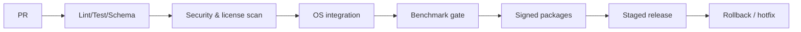

# 10 — Development Guide, Repository Layout, CI/CD & Release Operations

## Tech stack proposal

- **Language/core:** Rust stable; `serde`, `serde_json`, `tokio` or bounded std I/O (profile before committing), `thiserror`, `tracing` with a no-buffer logging policy.
- **UI candidate:** `egui` + `winit` for native/lightweight cross-platform rendering, with OS-specific window bridge as needed. This is an ADR proposal pending visual/accessibility/overlay POC, not a settled choice.
- **Shell scripts:** zsh ZLE, Bash Readline bindings/completions, PowerShell PSReadLine integration. Must pass `shellcheck` (where applicable), Pester for pwsh.
- **Schema/code generation:** JSON Schema Draft 2020-12, shared Rust/TypeScript type generators only if necessary.
- **Testing:** Rust unit/integration, cargo-fuzz (or equivalent), golden cases, OS E2E harness.

## Suggested monorepo

```text
terminal-companion/
├─ README.md
├─ docs/                        # this docs pack
├─ Cargo.toml                   # workspace
├─ crates/
│  ├─ companion-cli/            # install / doctor / config
│  ├─ companion-daemon/         # session manager + IPC
│  ├─ companion-core/           # parser + suggestion engine
│  ├─ companion-spec/           # schema validation + registry
│  ├─ companion-providers/      # filesystem + safe built-ins
│  ├─ companion-theme/          # theme acquisition + tokens
│  ├─ companion-overlay/        # egui/winit & OS bridge
│  └─ companion-protocol/       # IPC types, versioning
├─ adapters/
│  ├─ zsh/
│  ├─ bash/
│  ├─ powershell/
│  └─ fish/                     # P1
├─ specs/bundled/               # validated non-executable JSON
├─ schemas/
├─ examples/
├─ tests/
│  ├─ golden/
│  ├─ terminal-e2e/
│  └─ perf/
├─ installers/
│  ├─ macos/
│  ├─ linux/
│  └─ windows/
└─ .github/workflows/
```

## Developer bootstrap (proposed; not commands from an existing repo)

```bash
rustup toolchain install stable
cargo fmt --all -- --check
cargo clippy --workspace --all-targets -- -D warnings
cargo test --workspace
# cargo run -p companion-cli -- doctor   # after code exists
```

A fresh repo must set pinned `rust-toolchain.toml`, conventional commit / PR templates, dependency review, and OS-specific bootstrap instructions.

## Shell installer requirements

- `install --dry-run --shell zsh`: print exact target path, snippet, diff, permission request, uninstall command.
- Install marker block with stable unique header/footer; preserve encoding/line endings, symlinks, ownership and custom user config; backup before edits.
- Idempotent install/upgrade, and conflict detection if user edited marker block.
- `disable`: no runtime interceptions while keeping package; `uninstall`: remove only managed marker block and service.
- Windows profile paths can vary; installer discovers user-scoped PowerShell 7 profile; don't edit machine-wide scope silently.

## Build artifacts & distribution

| Platform | Candidate format | Needs |
|---|---|---|
| macOS | signed/notarized `.dmg` or `.pkg`, optional Homebrew cask | codesign identity, notarization, universal or arch-specific package |
| Linux | `.deb`, `.rpm` or AppImage after validating desktop deps | X11/Wayland dependencies clear, package uninstall scripts |
| Windows | signed `.msi` or installer `.exe`, WinGet manifest later | code signing, per-user default, PSReadLine compatibility |

Installer format selection is tentative; test transparent/uninstallation before deciding. Provide checksums/SBOM for each release.

## CI/CD pipeline



- Pull requests: code review + tests + docs/ADR updates when behavior changes.
- Branch protection on `main`; conventional changelog, semantic versioning `0.x` until stability.
- No automatic update/network requirement in MVP. Manual update notes with verifiable package signatures.
- Collect crash diagnostics **only with explicit user action**, review data before attachment.

## Observability without personal data

In-memory counters for engine latency, cache hit/miss, errors by class, render mode and theme source. `companion doctor --report` produces redacted output reviewed by user; explicit `--include-debug` still must exclude command buffers and secrets. No analytics backend by default.

## License, provenance & attribution

Repository license is TBD. Any imported Fig/withfig specs must be checked individually for license obligations and preserved attribution. The public `withfig/autocomplete` repo lists MIT license, but a repository-level label does not automatically clear every external dependency or asset. Avoid Fig logos/trademarks/brand identity.
